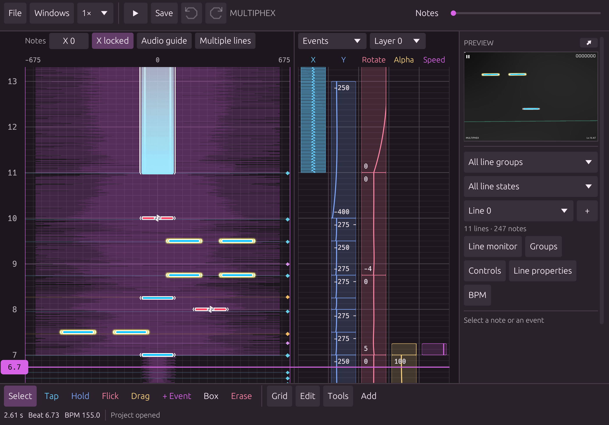

<h1 align="center">PhiStudio Rust</h1>

## Overview

PhiStudio Rust is a successor to the original Java-based [PhiStudio](https://github.com/BigCamper68/PhiStudio), rewritten from scratch in Rust. The editor is built around Phira's **`prpr`** rendering engine.

<p align="center">
  
</p>

## Features

- **Extensive automation and quality-of-life tools.** Batch Values, Note Generator, Event/Storyboard Tools, Motion Generator, Tool Configurations, and more.
- **Accurate real-time preview** powered by Phira's `prpr` renderer, including its parser, animation system, judgment logic, and shaders.
- **Cross-platform support.** A shared codebase for ~~desktop~~, Android, and iOS.
- **Native immediate-mode UI** built with `egui`. The editor and preview share a Macroquad/Miniquad GL context.
- **Audio cue analyzer.** A custom implementation that helps align notes with the music.
- **Built-in project version control.** A custom system for tracking changes to chart projects.
- **Format conversion.** Conversion rules ported from the Java version of PhiStudio.

## Platforms

| Platform | Directory |
|----------|-----------|
| ~~Windows / macOS / Linux~~ | [`desktop/`](desktop/) |
| Android | [`android/`](android/) |
| iOS | [`ios/`](ios/) |

## Project Structure

```text
PhiStudio-Rust/
├── crates/
│   ├── phistudio-core/    # chart model, conversion, project logic
│   ├── phistudio-prpr/    # editor integration layer for prpr
│   ├── phistudio-audio/   # audio playback and analysis
│   └── phistudio-app/     # editor application and UI
├── vendor/
│   ├── phira/             # vendored Phira / prpr renderer (GPL-3.0)
│   └── egui-miniquad/     # egui adapter with PhiStudio patches
├── desktop/               # desktop entry point
├── android/               # Android project
├── ios/                   # iOS project
├── assets/                # fonts, skins, icons
├── licenses/              # copies of third-party license texts
└── tools/                 # validation and icon-generation scripts
```

## Contributing

Issues and pull requests are welcome. If you are planning a major change, please open an issue to discuss it first.

## License

PhiStudio Rust is licensed under the **[GNU GPL v3.0 only](LICENSE)**.

## Acknowledgments

- [**Phira**](https://github.com/TeamFlos/phira) by Mivik and contributors: the `prpr` renderer that the editor is built around.
- [**PhiStudio (Java)**](https://github.com/BigCamper68/PhiStudio): by yours truly :D
- [egui](https://github.com/emilk/egui), [Macroquad](https://github.com/Mivik/prpr-macroquad), [Miniquad](https://github.com/Mivik/prpr-miniquad), [RustFFT](https://github.com/ejmahler/RustFFT), [Oboe](https://github.com/katyo/oboe-rs), and many other open-source projects listed in [THIRD_PARTY.md](THIRD_PARTY.md).
- [rpe-next](https://github.com/kclg-YSJ/rpe-next): inspired the behavior of many features.

---

<p align="center">Made by <a href="https://github.com/BigCamper68">BigCamper68</a></p>
